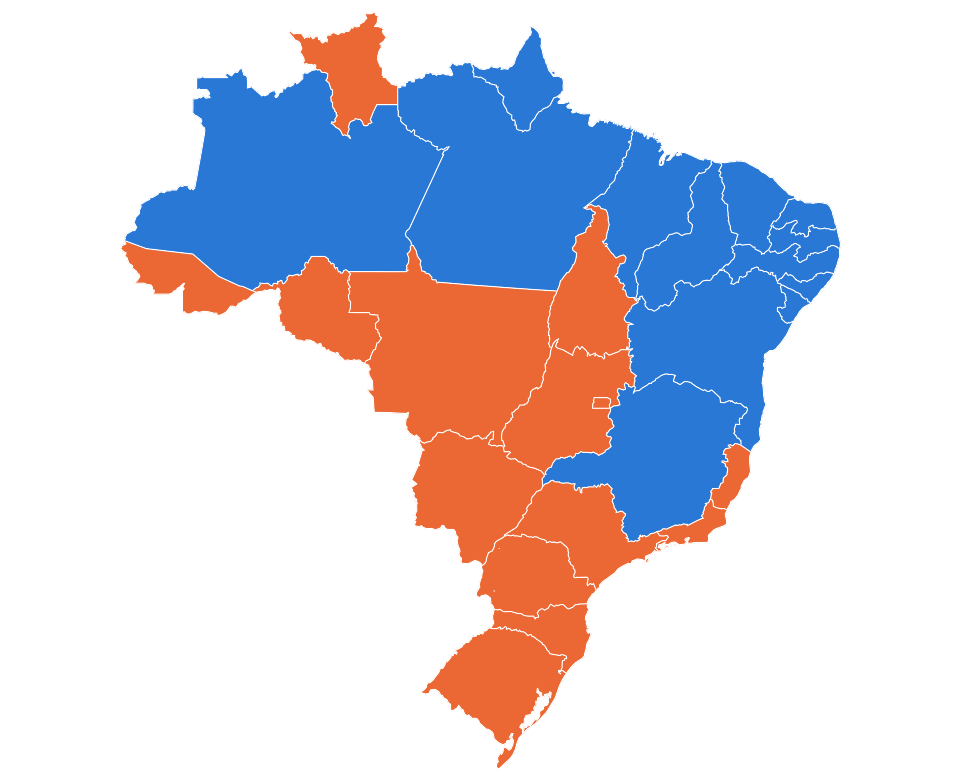

# TSE API

> API e painel web para consultar os dados públicos das eleições brasileiras: resultados, mapa e o
> boletim de urna de cada seção eleitoral, lido do arquivo oficial assinado pela urna.

[](https://github.com/williamgsilva/tse-api/actions/workflows/ci.yml)
[](https://github.com/williamgsilva/tse-api/actions/workflows/security.yml)
[](LICENSE)


<p align="center">
  
</p>

Começa pelas **Eleições 2026** (1º turno em 04/10 e 2º turno em 25/10), usando só fontes oficiais e abertas:
o portal de resultados e o Portal de Dados Abertos do TSE e a API de malhas do IBGE.

> **Projeto independente.** Não é um serviço do TSE nem tem vínculo com ele. Os números vêm dos arquivos
> públicos do Tribunal; em caso de divergência, vale a publicação oficial.

## Sumário

- [O que dá para fazer](#o-que-dá-para-fazer)
- [Início rápido](#início-rápido)
- [O painel](#o-painel)
- [A API](#a-api)
- [Base local de dados abertos](#base-local-de-dados-abertos)
- [Horário dos votos e sigilo](#horário-dos-votos-e-sigilo)
- [Fontes e confiabilidade](#fontes-e-confiabilidade)
- [Configuração](#configuração)
- [Arquitetura](#arquitetura)
- [Desenvolvimento](#desenvolvimento)
- [Contribuindo, segurança e licença](#contribuindo-segurança-e-licença)

## O que dá para fazer

- **Mapa do Brasil** por estado, região e município, colorido pelo partido mais votado ou pelo comparecimento.
  Do município se chega às zonas, às seções e ao boletim de cada urna.
- **Resultados totalizados** de qualquer cargo, no Brasil, numa UF ou num município.
- **Boletim de urna (BU) de qualquer seção**, decodificado do arquivo binário original: urna, horários de
  abertura e encerramento, aptos, comparecimento, biometria e votos por cargo, com nome e partido.
- **Arquivos originais da urna** para download: BU, registro digital do voto (RDV), log e assinatura.
- **Horário dos votos** de cada seção (log da urna) e quantos votos foram dados depois de um horário.
- **Somas sobre o país inteiro**, numa base local, por UF, município, zona, local de votação ou seção:
  votos por candidato, aptos, comparecimento, abstenção, biometria e votos por horário.

## Início rápido

**Requisitos:** Python 3.10+, Node.js 20+ e `make`. Opcionais: Docker, e
[`pre-commit`](https://pre-commit.com), [`gitleaks`](https://github.com/gitleaks/gitleaks) e
[`trivy`](https://trivy.dev) para os hooks e as varreduras de segurança.

```bash
git clone https://github.com/williamgsilva/tse-api.git
cd tse-api
make setup     # cria o .venv, instala as dependências (Python e Node) e copia o .env.example para .env
make run       # API em http://127.0.0.1:8000 (porta: APP_PORT no .env)
make dev       # em outro terminal: painel em http://127.0.0.1:5173, repassando /v1 para a API
```

- Documentação interativa da API (OpenAPI): <http://127.0.0.1:8000/docs>
- Para servir o painel pela própria API (uma porta só): `npm --prefix frontend run build` e `make run`;
  o painel fica em <http://127.0.0.1:8000>.

### Com Docker

```bash
make build                                         # imagem tse-api:<commit>, com API e painel
docker run --rm -p 8000:8000 -v tse-data:/data tse-api:<commit>
```

A imagem roda como usuário sem privilégios, guarda cache e base em `/data` e tem healthcheck em `/health/live`.

## O painel

| Página | O que mostra |
| ------ | ------------ |
| **Mapa** (`/`) | Brasil → região → estado → município. Cor pelo partido líder ou pelo comparecimento; painel lateral com eleitorado, composição dos votos e ranking; do município, zonas e seções |
| **Resultados** | Resultado completo de um cargo, com os mais votados em barras, para onde foram os votos e a tabela de candidaturas com busca |
| **Seções e boletins** | UF → município → zona → seção. O boletim mostra a urna, os horários, a biometria, os votos por cargo, o gráfico de votos por horário e os arquivos originais |
| **Análises** | Somas da base local: comparecimento e biometria agrupados, votos por horário, estimativa de votos depois de um horário e mapa de calor por município |
| **Dados abertos** | O que foi importado na base local e somas de votos por candidato |

Tem tema claro, escuro ou do sistema. O estado de cada tela fica na URL, então dá para compartilhar o link.
Os gráficos e o mapa têm legenda, tabela com os mesmos dados e navegação por teclado.

## A API

Todas as rotas ficam em `/v1`. Rotas e campos do JSON usam os termos do TSE, em português e `snake_case`
([ADR 0003](docs/architecture/adr/0003-codigo-em-ingles-contrato-em-portugues.md)).

**Códigos de 2026:** pleito `3220` = 1º turno e `3221` = 2º turno. Eleições `6257`/`6258` (federal) e
`6259`/`6260` (estadual). Cargos: `1` Presidente, `3` Governador, `5` Senador, `6` Deputado Federal,
`7` Deputado Estadual, `8` Deputado Distrital. Município e zona usam o **código do TSE**; a rota
`/municipios` traz também o código IBGE. UF em sigla (`sp`); `br` é o Brasil e `zz`, o exterior.

### Eleições, resultados e mapas (consulta ao vivo no TSE)

| Rota | Retorna |
| ---- | ------- |
| `GET /v1/eleicoes?ano=2026` | Pleitos, eleições e cargos |
| `GET /v1/eleicoes/{eleicao}/municipios?uf=` | Municípios (código TSE e IBGE) e zonas |
| `GET /v1/eleicoes/{eleicao}/abrangencias/{uf}` | Seções totalizadas, eleitorado e comparecimento |
| `GET /v1/eleicoes/{eleicao}/resultados/{uf}/{cargo}?municipio=` | Candidatos, votos, percentuais e eleitos |
| `GET /v1/eleicoes/{eleicao}/resultados/{uf}/{cargo}/subdivisoes?limite=3` | Resultado de cada UF (com `uf=br`) ou de cada município da UF |
| `GET /v1/mapas/brasil` · `GET /v1/mapas/{uf}` | GeoJSON do Brasil por UF ou da UF por município (malhas do IBGE) |

### Seções e boletins de urna (consulta ao vivo no TSE)

| Rota | Retorna |
| ---- | ------- |
| `GET /v1/pleitos/{pleito}/secoes/{uf}?municipio=&zona=&limit=&cursor=` | Seções com arquivos de urna (paginação por cursor) |
| `GET /v1/pleitos/{pleito}/secoes/{uf}/{municipio}/{zona}/{secao}` | Situação da seção e transmissões da urna |
| `GET …/{secao}/boletim?nomes=true` | Boletim de urna decodificado |
| `GET …/{secao}/horarios?apos=17:00` | Votos a cada 15 minutos e estimativa dos votos depois do horário |
| `GET …/{secao}/arquivos/{tipo}` | Arquivo original: `bu`, `rdv`, `log` ou `vota` |

### Base local (depois de importar)

| Rota | Retorna |
| ---- | ------- |
| `GET /v1/dados-abertos/importacoes` | O que foi importado |
| `GET /v1/dados-abertos/{ano}/{turno}/secoes/{uf}/{municipio}/{zona}/{secao}` | Boletim da seção a partir do CSV |
| `GET /v1/dados-abertos/{ano}/{turno}/votacao/{cargo}` | Soma de votos por candidato |
| `GET /v1/dados-abertos/{ano}/{turno}/comparecimento` | Aptos, comparecimento, abstenção e biometria |
| `GET /v1/dados-abertos/{ano}/{turno}/horarios?intervalo=15` | Votos por horário de Brasília e tipo de habilitação |
| `GET /v1/dados-abertos/{ano}/{turno}/votos-apos/{cargo}?apos=17:00` | Total exato depois do horário e estimativa por candidato |

Agrupe com `agrupar=total|uf|municipio|zona|local|secao` e filtre com `uf`, `municipio`, `zona`, `secao`
e, conforme a rota, `tipo_urna`, `votavel` e `encerramento_apos`.

### Saúde

`GET /health/live` (processo no ar) e `GET /health/ready` (portal do TSE acessível; informa se há base local).

### Exemplos

```bash
# Resultado do 2º turno presidencial no Brasil
curl -s localhost:8000/v1/eleicoes/6258/resultados/br/1 | jq '.cargos[0].candidatos[] | {nome_urna, votos, percentual}'

# Boletim de urna da seção 77, zona 4, Porto Walter (AC), 1º turno
curl -s localhost:8000/v1/pleitos/3220/secoes/ac/1066/4/77/boletim | jq '{comparecimento, votacao, detalhamento_comparecimento}'

# Votos dessa seção depois das 17h de Brasília
curl -s "localhost:8000/v1/pleitos/3220/secoes/ac/1066/4/77/horarios?apos=17:00" | jq '{votos_apos, comparecimento}'

# Comparecimento e biometria por município do Acre (base local)
curl -s "localhost:8000/v1/dados-abertos/2026/1/comparecimento?uf=ac&agrupar=municipio" | jq '.[0]'
```

### Erros

Os erros seguem o formato **Problem Details (RFC 9457)**, com `Content-Type: application/problem+json` e
um `traceId` igual ao cabeçalho `X-Request-ID`, que aparece nos logs:

```json
{
  "type": "/problems/section-not-found",
  "title": "Seção sem arquivos de urna publicados",
  "status": 404,
  "detail": "seção sem arquivos de urna publicados: …",
  "instance": "/v1/pleitos/3220/secoes/ac/1066/4/9999/boletim",
  "traceId": "4bf92f3577b34da6a3ce929d0e0e4736"
}
```

| Status | Quando |
| ------ | ------ |
| 404 | Eleição, seção ou arquivo que o TSE não publicou |
| 422 | Parâmetro inválido (UF, horário, cursor, agrupamento…) |
| 502 | Portal do TSE ou do IBGE fora do ar, ou dado inválido recebido deles |
| 503 | Base local vazia ou em importação |

## Base local de dados abertos

As consultas que somam o país inteiro usam uma base local [DuckDB](https://duckdb.org) em `data/bweb.duckdb`
([ADR 0004](docs/architecture/adr/0004-duckdb-para-boletins-de-dados-abertos.md)), carregada a partir do
Portal de Dados Abertos do TSE:

```bash
make ingest ARGS="--listar --fonte ambos"              # o que o TSE já publicou
make ingest ARGS="--turno 1 2 --uf AC SP"              # CSV de boletins (votos por candidato e seção)
make ingest ARGS="--turno 1 --uf AC --fonte urnas"     # pacote de urnas (biometria e horário dos votos)
make ingest ARGS="--turno 1 2 --todas --fonte ambos"   # Brasil inteiro
```

| `--fonte` | Conteúdo | Tamanho (1º turno) |
| --------- | -------- | ------------------ |
| `boletins` (padrão) | CSV com votos por candidato, cargo e seção; aptos e comparecimento | AC 17 MB · SP ~1 GB |
| `urnas` | Boletim e log de cada urna: biometria detalhada e horário de cada voto | AC 394 MB · SP 20 GB |
| `ambos` | Os dois | — |

- Cada carga confere o SHA-512 publicado pelo TSE (quando existe) e substitui os dados daquele ano, turno e
  UF numa transação. Os ZIPs são apagados depois da carga (`--manter-arquivos` para guardar).
- O pacote de urnas é decodificado em paralelo: o Acre inteiro (2.270 urnas) em cerca de 5 segundos.
- O importador avisa quando um turno pedido ainda não foi publicado.
- A API abre a base só para leitura. Durante uma importação, as rotas `/v1/dados-abertos` respondem 503.

## Horário dos votos e sigilo

O log da urna registra **a hora de cada voto** e **como o eleitor foi habilitado** (biometria, ano de
nascimento ou sem biometria), mas **nunca em quem ele votou**. O sigilo é garantido por projeto: o registro
digital do voto (RDV) guarda os votos embaralhados e sem horário.

Por isso:

- **"Quantos votos foram dados depois das 17h"** é uma **contagem exata**, feita no log.
- **"Quantos desses votos foram para o candidato X"** só existe como **estimativa**: em cada seção, os
  votos tardios são distribuídos na mesma proporção dos votos daquela seção, e as seções são somadas.
  A API e o painel marcam esse número como estimativa.

O log usa o horário local da urna. A API converte para o horário de Brasília pelo fuso de cada município,
deduzido da hora do primeiro voto (a votação começa às 8h de Brasília no país todo). Isso cobre o Acre, o
oeste do Amazonas e Fernando de Noronha. No exterior, o horário fica no fuso local do país.

## Fontes e confiabilidade

| Fonte | Uso |
| ----- | --- |
| [Portal de resultados do TSE](https://resultados.tse.jus.br) | Consultas ao vivo, com cache em memória (JSON) e em disco (arquivos de urna) |
| [Portal de Dados Abertos do TSE](https://dadosabertos.tse.jus.br) | CSVs de boletins e pacotes de arquivos de urna, importados para a base local |
| [API de malhas do IBGE](https://servicodados.ibge.gov.br/api/docs/malhas) | Limites de estados e municípios para os mapas ([ADR 0006](docs/architecture/adr/0006-mapas-com-malhas-do-ibge.md)) |

- O boletim é decodificado com a especificação ASN.1 publicada pelo TSE
  ([`bu.asn1`](src/tse_api/modules/ballots/infrastructure/spec/bu.asn1)).
- Conferências feitas com dados reais de 2026:
  - o boletim decodificado de uma seção bate voto a voto com o CSV de dados abertos da mesma seção;
  - a soma das 2.270 seções do Acre bate com o total oficial do estado (613.742 aptos e 488.330 votantes);
  - a contagem por tipo de habilitação no log bate com o detalhamento de comparecimento do boletim.
- Os testes usam arquivos reais do TSE (em [`tests/fixtures/`](tests/fixtures/)) e rodam sem acesso à rede.
- **Ainda não feito:** verificar as assinaturas digitais do boletim e decodificar o RDV.

## Configuração

Todas as variáveis estão em [`.env.example`](.env.example); `make setup` copia o arquivo para `.env`.

| Variável | Padrão | Para quê |
| -------- | ------ | -------- |
| `APP_HOST` / `APP_PORT` | `127.0.0.1` / `8000` | Endereço da API em `make run` |
| `LOG_LEVEL` / `LOG_FORMAT` | `info` / `json` | Nível e formato dos logs (`json` ou `text`) |
| `TSE_RESULTADOS_BASE` | `https://resultados.tse.jus.br/oficial` | Portal de resultados |
| `TSE_DADOS_ABERTOS_BASE` | `https://dadosabertos.tse.jus.br` | Portal de Dados Abertos |
| `IBGE_MALHAS_BASE` | `https://servicodados.ibge.gov.br/api/v3/malhas` | Malhas do IBGE |
| `TSE_JSON_TTL` | `900` | Segundos de cache em memória dos JSONs do TSE |
| `TSE_MAX_CONCURRENCY` | `16` | Requisições simultâneas ao TSE |
| `TSE_USER_AGENT` | `tse-api/0.1 (…)` | Identificação enviada aos portais |
| `TSE_DATA_DIR` | `data` | Cache de arquivos de urna e malhas, downloads e base local |
| `TSE_DB_PATH` | `$TSE_DATA_DIR/bweb.duckdb` | Caminho da base local |
| `FRONTEND_DIST` | `frontend/dist` | Build do painel servido pela API (inexistente = só a API) |
| `CORS_ORIGINS` | vazio | Origens liberadas, separadas por vírgula (desnecessário com `make dev`) |

## Arquitetura

Monólito modular com arquitetura hexagonal
([ADR 0002](docs/architecture/adr/0002-monolito-modular-hexagonal.md)). A regra de dependência entre
camadas e módulos é verificada pelo [`import-linter`](https://import-linter.readthedocs.io) a cada
`make lint`. Visão geral, diagramas C4 e riscos: [docs/architecture/overview.md](docs/architecture/overview.md).

```text
src/tse_api/
├── bootstrap/          # composition root: app FastAPI, erros RFC 9457, painel (SPA) e CLI tse-ingest
├── shared/             # config, erros base, cliente HTTP do TSE, paginação, UFs e regiões, logs JSON
└── modules/
    ├── elections/      # catálogo, resultados totalizados e resultados por subdivisão
    ├── ballots/        # seções, arquivos de urna, boletim de urna (ASN.1) e log da urna
    ├── geography/      # malhas do IBGE para os mapas
    └── open_data/      # importação dos dados abertos e consultas na base DuckDB
        └── {domain, application, infrastructure, interfaces}/
frontend/               # React 18 + Vite + TypeScript, TanStack Query e d3-geo
tests/                  # unit / integration / e2e, com arquivos reais do TSE em tests/fixtures
docs/                   # arquitetura e ADRs, glossário, padrões, operação
```

| Decisão | Registro |
| ------- | -------- |
| Registrar decisões em ADR | [0001](docs/architecture/adr/0001-registrar-decisoes-com-adr.md) |
| Monólito modular + hexagonal | [0002](docs/architecture/adr/0002-monolito-modular-hexagonal.md) |
| Código em inglês, contrato da API em português | [0003](docs/architecture/adr/0003-codigo-em-ingles-contrato-em-portugues.md) |
| DuckDB local para os dados abertos | [0004](docs/architecture/adr/0004-duckdb-para-boletins-de-dados-abertos.md) |
| Painel React servido pela própria API | [0005](docs/architecture/adr/0005-frontend-spa-servido-pela-api.md) |
| Mapas com as malhas do IBGE e d3-geo | [0006](docs/architecture/adr/0006-mapas-com-malhas-do-ibge.md) |

Os termos do domínio (pleito, seção, votável, habilitação…) e seus nomes no código estão no
[glossário](docs/glossario.md).

## Desenvolvimento

| Comando | O que faz |
| ------- | --------- |
| `make help` | Lista os comandos |
| `make setup` | Ambiente local: `.venv`, dependências, `.env` e git hooks |
| `make run` / `make dev` | API com recarga automática / painel em modo desenvolvimento |
| `make ingest ARGS="…"` | Importa dados abertos para a base local |
| `make lint` | pre-commit, ruff, mypy, import-linter, eslint, tsc e prettier |
| `make format` | Formata Python (ruff) e TypeScript (prettier + eslint) |
| `make test` | pytest com cobertura (mínimo de 80% em domain e application) e vitest |
| `make security` | gitleaks e trivy (falha se encontrar algo) |
| `make build` | Imagem Docker com API e painel |
| `make check` | `lint` + `test` + `security`: o mesmo que a CI exige |

**Qualidade.** O backend usa ruff, mypy e import-linter, com testes unitários, de integração (adaptadores
contra arquivos reais) e ponta a ponta (API inteira com o TSE simulado). O frontend usa eslint (com regras de
acessibilidade), TypeScript estrito, prettier, Vitest e Testing Library.

**CI e segurança.** No GitHub Actions rodam lint, testes e build em todo PR; também rodam gitleaks, trivy,
CodeQL (Python e TypeScript), OpenSSF Scorecard e Dependabot (pip, npm, Docker e Actions). As actions são
fixadas por SHA.

**Versões.** Os commits seguem [Conventional Commits](https://www.conventionalcommits.org/pt-br/); o
release-please gera a versão (SemVer), o [CHANGELOG](CHANGELOG.md) e o release com SBOM assinado.

**Agentes de IA.** O [AGENTS.md](AGENTS.md) traz as regras do projeto para qualquer agente (Claude Code,
Copilot, Cursor, Codex). O Claude Code tem também skills (`/planejar`, `/spec`, `/revisar`, `/verificar`,
`/adr`), permissões e hooks em [`.claude/`](.claude/); detalhes em [docs/prompts/](docs/prompts/README.md).

## Contribuindo, segurança e licença

- **Contribuir:** contribuições são bem-vindas! O caminho é sempre o mesmo: fork, **branch nova** e
  **pull request** para a `main`, que é protegida e só recebe mudanças revisadas e com a CI verde. Passo a
  passo, padrão de branches e definição de pronto em [CONTRIBUTING.md](CONTRIBUTING.md); padrões de código,
  testes e API em [docs/standards/](docs/standards/).
- **Conduta:** este é um projeto sobre dados, não um espaço de campanha; veja o
  [Código de Conduta](CODE_OF_CONDUCT.md).
- **Manter o repositório:** proteção de branch, secrets e rotina em
  [docs/manutencao-do-repositorio.md](docs/manutencao-do-repositorio.md).
- **Vulnerabilidades:** não abra issue pública; veja [SECURITY.md](SECURITY.md).
- **Licença:** [MIT](LICENSE). Os dados eleitorais são públicos e pertencem às suas fontes (TSE e IBGE).
