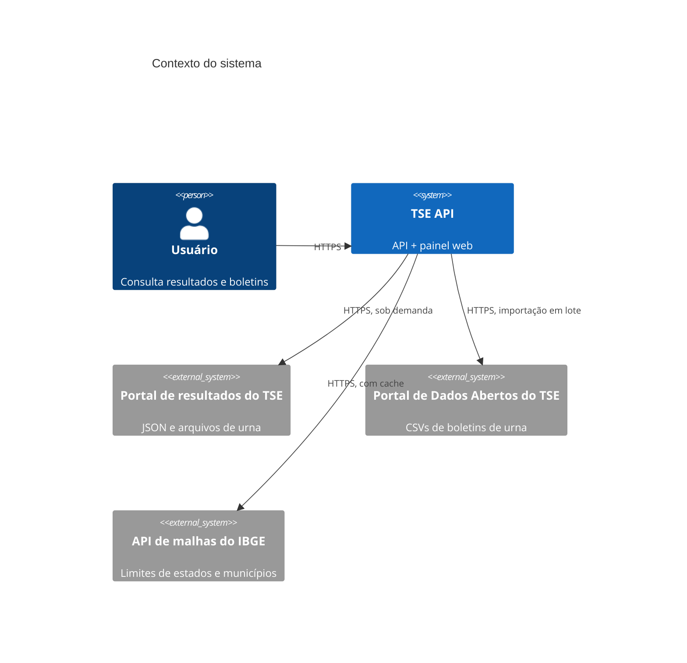
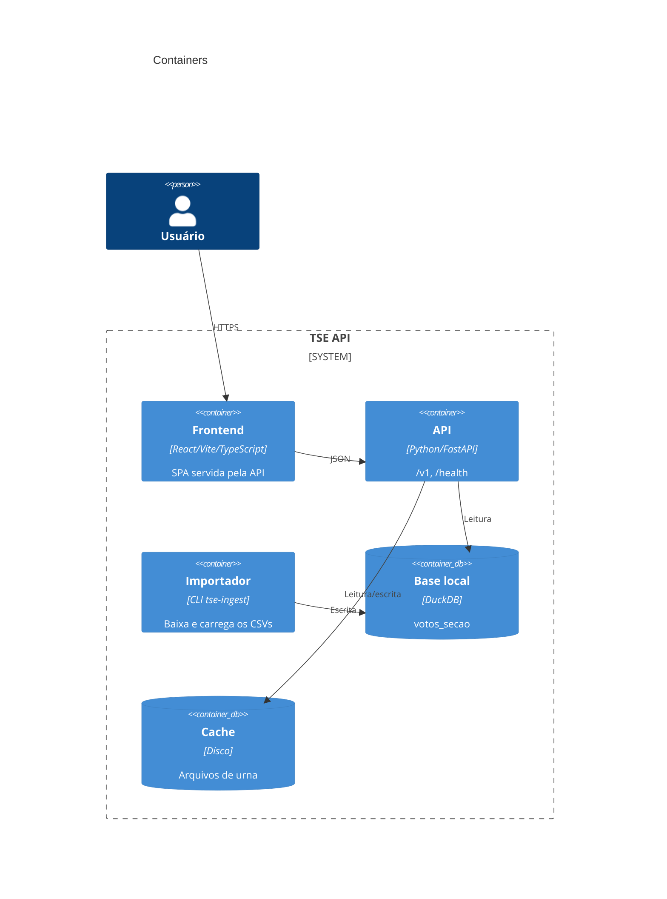

# Visão geral da arquitetura

> Documento vivo. Atualize quando o sistema mudar de forma relevante.
> Estrutura inspirada no [arc42](https://arc42.org) (enxuto) + [C4 Model](https://c4model.com).

## 1. Contexto e objetivo

- **Problema:** os dados das eleições estão espalhados entre o portal de resultados (JSON com chaves
  abreviadas e boletins binários em ASN.1) e o Portal de Dados Abertos (CSVs grandes em latin-1). Não existe
  uma forma simples de consultar o boletim de uma seção ou somar votos por região.
- **Usuários / atores:** pessoas interessadas em conferir resultados (jornalistas, pesquisadores, cidadãos)
  e sistemas que consomem a API.
- **Fora de escopo:** dados pessoais de eleitores, autenticação, escrita de dados, verificação criptográfica
  das assinaturas da urna (por enquanto).

## 2. Escopo do MVP

| # | Capacidade | Prioridade (MoSCoW) |
| - | ---------- | ------------------- |
| 1 | Catálogo de pleitos, eleições e cargos de 2026 | Must |
| 2 | Resultado totalizado por cargo (Brasil, UF, município) | Must |
| 3 | Boletim de urna decodificado de qualquer seção, com nomes de candidatos | Must |
| 4 | Download dos arquivos originais da urna (BU, RDV, log, assinatura) | Should |
| 5 | Importação dos CSVs de dados abertos e somas por UF/município/zona/seção | Should |
| 6 | Frontend para navegar resultados, seções e boletins | Should |
| 7 | Comparecimento e biometria agrupados; votos por horário (log da urna) e estimativa de votos após um horário | Should |
| 8 | Mapa interativo (Brasil, região, UF, município → zonas e seções) | Should |
| 9 | Decodificar RDV e verificar assinaturas digitais | Could |

## 3. Requisitos não funcionais (mensuráveis)

| Atributo        | Meta                                    | Como medir             |
| --------------- | --------------------------------------- | ---------------------- |
| Performance     | p95 < 300 ms para respostas em cache; boletim de seção < 2 s sem cache | logs de requisição (`ms`) |
| Disponibilidade | depende do portal do TSE; `/health/ready` reporta a dependência | health check |
| Segurança       | só leitura, sem dados pessoais; entrada validada na borda; SQL parametrizado | `make lint`, CodeQL, trivy |
| Uso do TSE      | no máximo `TSE_MAX_CONCURRENCY` requisições simultâneas; cache em memória e em disco | configuração |
| Manutenibilidade| cobertura ≥ 80% em domain e application; contratos de arquitetura (import-linter) | CI |

## 4. Restrições

- Fontes oficiais só leitura: `resultados.tse.jus.br` e `dadosabertos.tse.jus.br`. Formatos podem mudar
  entre eleições (ex.: o arquivo `imgbu` de 2022 não existe em 2026).
- O BU é decodificado com a especificação ASN.1 publicada pelo TSE (`bu.asn1`).
- Base local DuckDB com um único escritor ([ADR 0004](adr/0004-duckdb-para-boletins-de-dados-abertos.md)).

## 5. C4 — Nível 1: Contexto

## 6. C4 — Nível 2: Containers

## 7. Módulos (bounded contexts)

| Módulo | Responsabilidade | Depende de |
| ------ | ---------------- | ---------- |
| `elections` | Catálogo (pleitos, eleições, cargos), municípios, resultados totalizados e abrangências | `shared` |
| `ballots` | Seções, arquivos de urna, decodificação do BU e nomes dos votáveis | `elections` (API pública: `GetVotingEvent`, `GetElectionResult`) |
| `geography` | Malhas do IBGE (Brasil por UF, UF por município) para os mapas, com cache em disco | `shared` |
| `open_data` | Importação dos CSVs e dos pacotes de urnas; comparecimento, horários e votos após um horário na base DuckDB | `shared`, `ballots` (API pública: decodificador do BU e leitor do log) |

Exceção registrada: a camada `interfaces` importa tipos do `domain` (entidades e value objects) só para
tipagem das respostas e para montar objetos de entrada (ex.: `VoteQuery`); ela nunca chama portas ou
adaptadores. Os contratos do `import-linter` garantem o resto da regra de dependência.

## 8. Decisões

Ver [ADRs](adr/). Liste aqui as mais importantes:

- [ADR 0001](adr/0001-registrar-decisoes-com-adr.md) — Registrar decisões com ADR
- [ADR 0002](adr/0002-monolito-modular-hexagonal.md) — Monólito modular + hexagonal
- [ADR 0003](adr/0003-codigo-em-ingles-contrato-em-portugues.md) — Código em inglês, contrato em português
- [ADR 0004](adr/0004-duckdb-para-boletins-de-dados-abertos.md) — DuckDB local para os dados abertos
- [ADR 0005](adr/0005-frontend-spa-servido-pela-api.md) — Frontend SPA servido pela API
- [ADR 0006](adr/0006-mapas-com-malhas-do-ibge.md) — Mapas com as malhas do IBGE e d3-geo

## 9. Riscos e débitos técnicos

| Risco / débito | Impacto | Mitigação | Issue |
| -------------- | ------- | --------- | ----- |
| TSE muda caminhos ou formatos entre eleições | Endpoints ao vivo quebram | Fixtures reais nos testes; caminhos isolados nos adaptadores | — |
| Sem rate limiting na API | Uso abusivo repassado ao TSE | Concorrência limitada ao TSE e cache; adicionar rate limit antes de expor publicamente | — |
| Assinaturas do BU não são verificadas | Confiança depende do canal HTTPS do TSE | Implementar verificação com `assinatura.asn1` | — |
| Sem OpenTelemetry | Só logs JSON com `traceId` | Adicionar OTEL quando houver produção | — |
